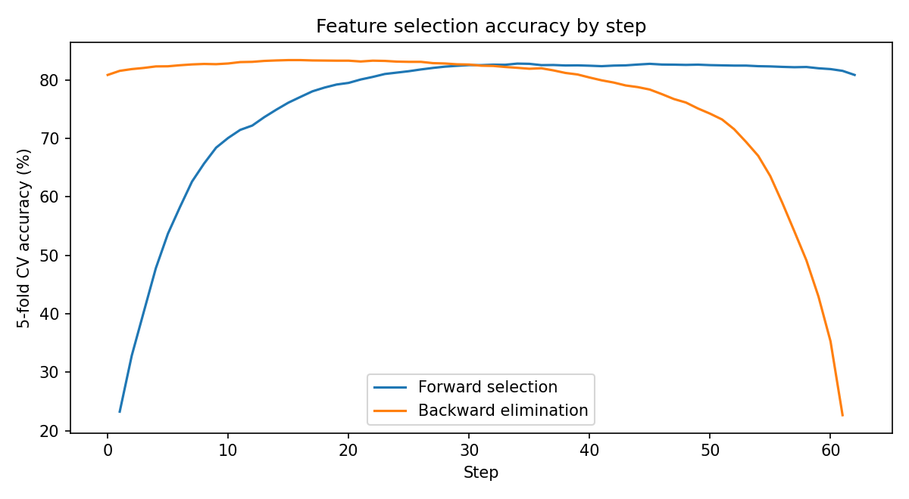
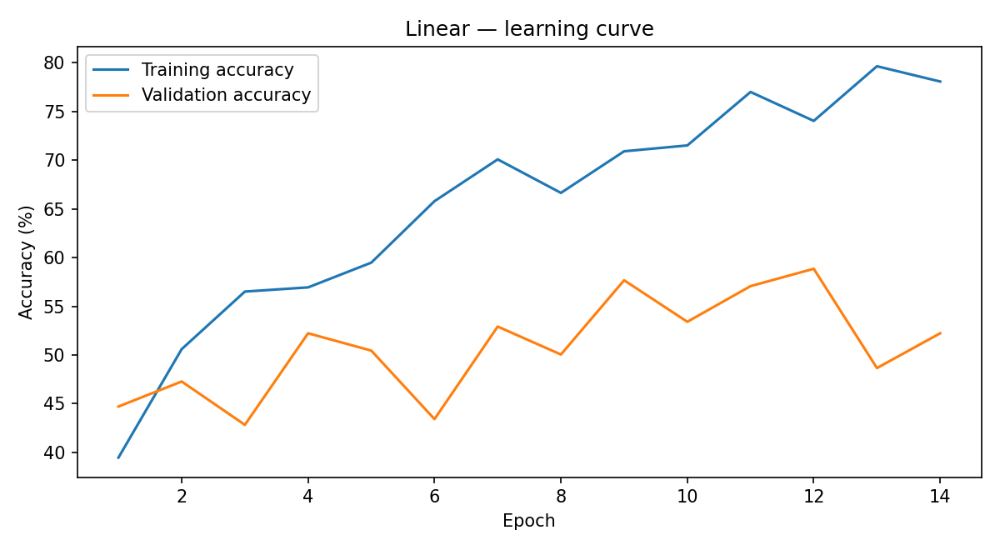
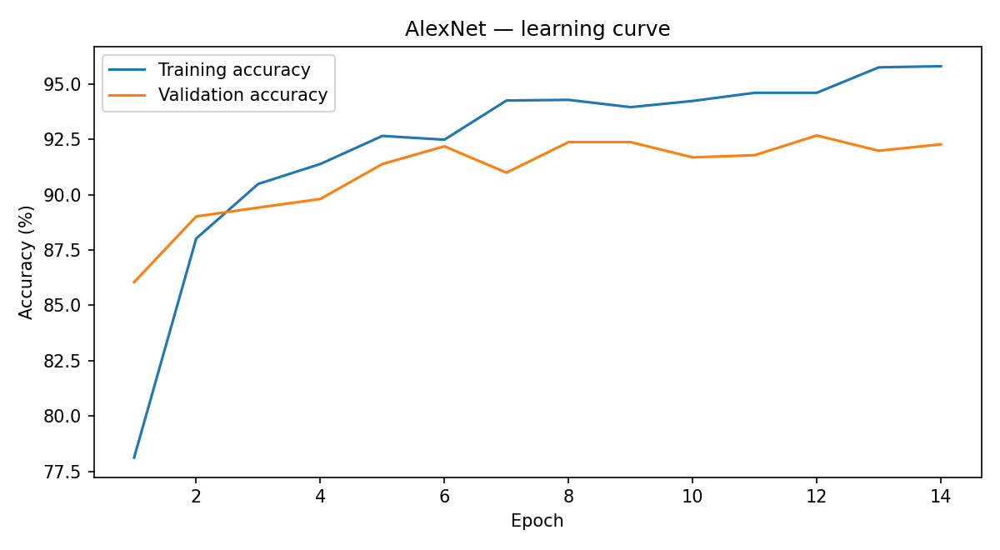
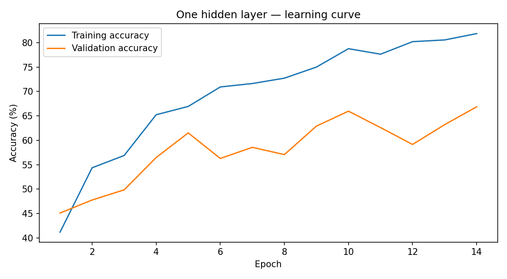
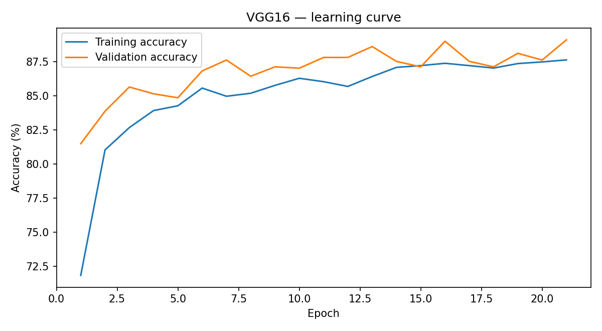
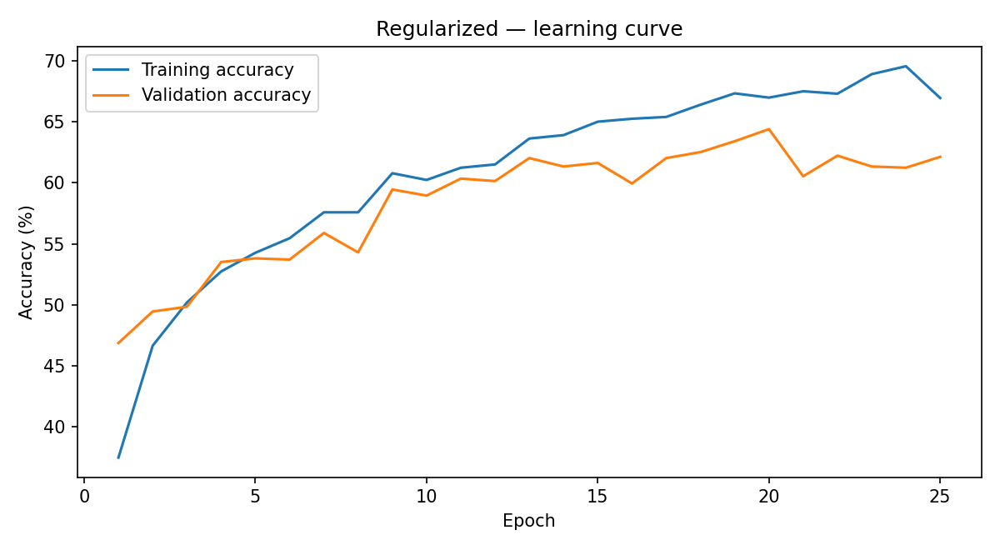

# Feature Selection and Flower Image Classification

Two experiments from a machine learning coursework assignment explore (1) greedy feature selection for a Gaussian Naive Bayes classifier and (2) multiclass flower classification using fully connected networks and pretrained convolutional networks.

## Repository contents

```text
.
├── feature selection.ipynb  
├── multiclass flower classification.ipynb 
├── results/                      # Plots reconstructed from notebook logs
│   ├── feature-selection-accuracy.png
│   ├── linear-accuracy.png
│   ├── one-hidden-layer-accuracy.png
│   ├── regularized-accuracy.png
│   ├── alexnet-accuracy.png
│   └── vgg16-accuracy.png
└── README.md
```

## Feature Selection with Gaussian Naive Bayes

### Objective and data

Compare **sequential forward selection** and **backward elimination** using Gaussian Naive Bayes and stratified 5-fold cross-validation. The supplied tabular training set has **5,000** examples and the test set has **2,500**. The notebook reads four local files: `trainData.csv`, `trainLabels.csv`, `testData.csv`, and `testLabels.csv`. These CSV files are **not included** in the uploaded notebooks/repository package and must be supplied to reproduce the run.

### Approach

1. Load numeric features and labels from CSV files.
2. Remove features with variance at most $0.90(1-0.90)=0.09$, leaving **62 features** in the saved run.
3. Estimate the correct classification rate (CCR) with **5-fold stratified cross-validation**, shuffled with random seed 42.
4. In **forward selection**, start with an empty feature subset and repeatedly add the feature that gives the highest cross-validation accuracy.
5. In **backward elimination**, start with all 62 features and repeatedly remove the feature whose removal gives the highest cross-validation accuracy.
6. Fit Gaussian Naive Bayes on the best *forward-selected* subset and evaluate on the held-out test set.

The Gaussian Naive Bayes class-conditional model assumes the features are conditionally independent within each class:

$$
p(x\mid y=c)=\prod_{j=1}^{d}\frac{1}{\sqrt{2\pi\sigma_{cj}^{2}}}\exp\left(-\frac{(x_j-\mu_{cj})^{2}}{2\sigma_{cj}^{2}}\right).
$$

The classifier chooses the class with the highest posterior probability:

$$
\hat y=\arg\max_c\;p(y=c)\,p(x\mid y=c).
$$

Feature subsets are scored with average cross-validation accuracy:

$$
\mathrm{CCR}_{\mathrm{CV}}(S)=\frac{100}{5}\sum_{k=1}^{5}\frac{\text{correct predictions in fold }k}{\text{examples in fold }k}.
$$

### Results

| Feature selection | Features in selected subset | Best 5-fold CV CCR |
|---|---:|---:|
| Forward selection | 34 | **82.78%** |
| Backward elimination | 47 | **83.38%** |
| All features, before sequential selection | 62 | 80.84% |

**Held-out test CCR: 77.40%**, using the 34-feature forward-selected subset. Although backward elimination had the higher cross-validation score, the notebook did **not** test its selected subset on the held-out test data. Feature indices refer to the 62-column matrix *after variance filtering*.




## Flower Image Classification

### Objective and data

Compare three fully connected image classifiers trained from scratch against two pretrained CNNs used as **frozen feature extractors**. The notebook downloads a flower dataset from [Google Drive](https://drive.google.com/file/d/1NkwiO41LZtZiCXD80mJJv1XzaM3tv7ud/view), extracts it to `flowers/`, and uses `flowers/train/` and `flowers/val/` subdirectories with class-specific folders. The notebook itself does not print dataset sizes, so no sample count is assumed here.

### Preprocessing and models

Images are resized to **128 × 128** for models trained from scratch and **224 × 224** for transfer learning, converted to tensors, and normalized channelwise using means $[0.485, 0.456, 0.406]$ and standard deviations $[0.229, 0.224, 0.225]$:

$$
x'_{c,h,w}=\frac{x_{c,h,w}-\mu_c}{\sigma_c}.
$$

The scratch-trained models are:

- **Linear classifier:** flatten each $3\times128\times128$ image, followed by a linear classification layer.
- **One-hidden-layer network:** flatten, 128-unit fully connected layer, ReLU, then the classification layer.
- **Regularized network:** flatten, 128-unit fully connected layer, batch normalization, ReLU, dropout ($p=0.5$), and the classification layer. Adam uses weight decay of $10^{-4}$ for this model only.

For transfer learning, pretrained **AlexNet** and **VGG16** have all existing parameters frozen; only the final classification layer is replaced and trained for the flower classes.

All models use multiclass cross-entropy loss:

$$
\mathcal L=-\frac{1}{N}\sum_{i=1}^{N}\log\left(\frac{e^{z_{i,y_i}}}{\sum_{c=1}^{C}e^{z_{i,c}}}\right).
$$

The regularized classifier also uses a weight-decay term, conceptually equivalent to penalizing large weights:

$$
\mathcal L_{\mathrm{reg}}=\mathcal L+\lambda\lVert W\rVert_2^2.
$$

Training uses Adam with learning rate **0.001**, batch size **32**, a maximum of **50 epochs**, and early stopping after **5 epochs without improved validation loss**. The training function restores the model checkpoint with the lowest validation loss.

### Recorded results

The columns below distinguish **last logged epoch accuracy**, **highest observed validation accuracy**, and **validation accuracy at the lowest-validation-loss checkpoint** (the checkpoint actually restored by the training function). These may differ.

| Model | Epochs run | Last-epoch val. accuracy | Highest logged val. accuracy | Accuracy at restored checkpoint |
|---|---:|---:|---:|---:|
| Linear | 14 | 52.23% | 58.85% | 57.67% |
| One hidden layer | 14 | 66.86% | 66.86% | 62.91% |
| BatchNorm + dropout + weight decay | 25 | 62.12% | 64.39% | 64.39% |
| AlexNet (frozen backbone) | 14 | **92.28%** | **92.68%** | **92.38%** |
| VGG16 (frozen backbone) | 21 | 89.12% | 89.12% | 89.02% |

**Key finding:** Pretrained CNN features substantially outperform the fully connected baselines in the recorded validation runs. **AlexNet** has the highest observed validation accuracy (**92.68%**) and the highest accuracy at the selected minimum-loss checkpoint (**92.38%**). These are **validation**, not independent test-set, results. No separate flower test-set evaluation was recorded.

#### Learning curves

The figures below are reconstructed from the stored, per-epoch textual logs in the original notebook, rather than retraining the models.

| Scratch-trained models | Frozen CNN backbones |
|---|---|
|  |  |
|  |  |
|  | |


## Tools and libraries

Python, NumPy, scikit-learn, PyTorch, torchvision, Matplotlib, Jupyter, and gdown.

## Attribution

Coursework project by **Fateme Roshani**. The notebooks retain the original experiment implementations and saved outputs; descriptive cell headings and this README were added for GitHub presentation.
